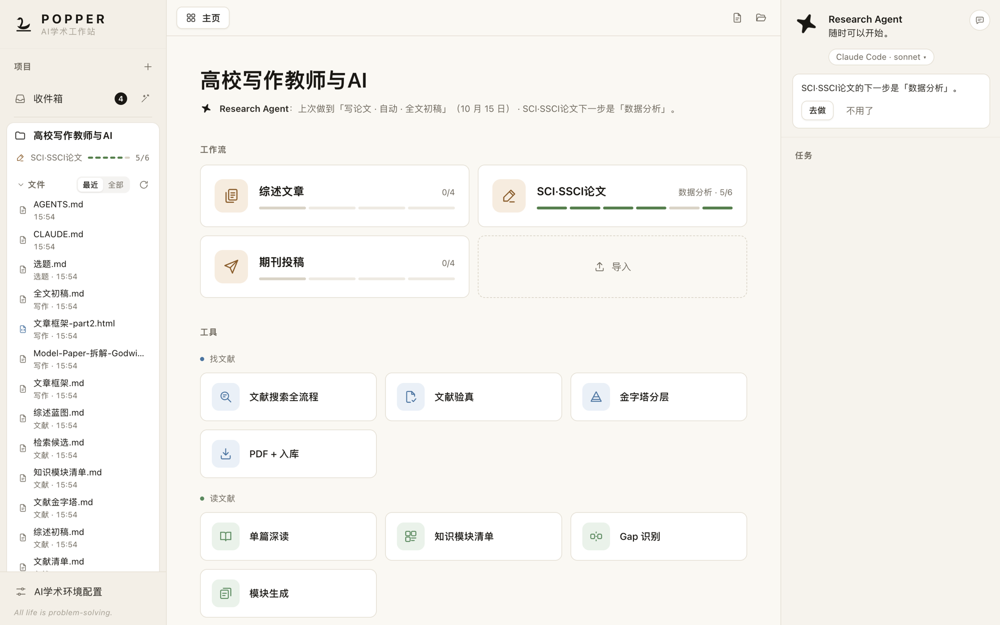
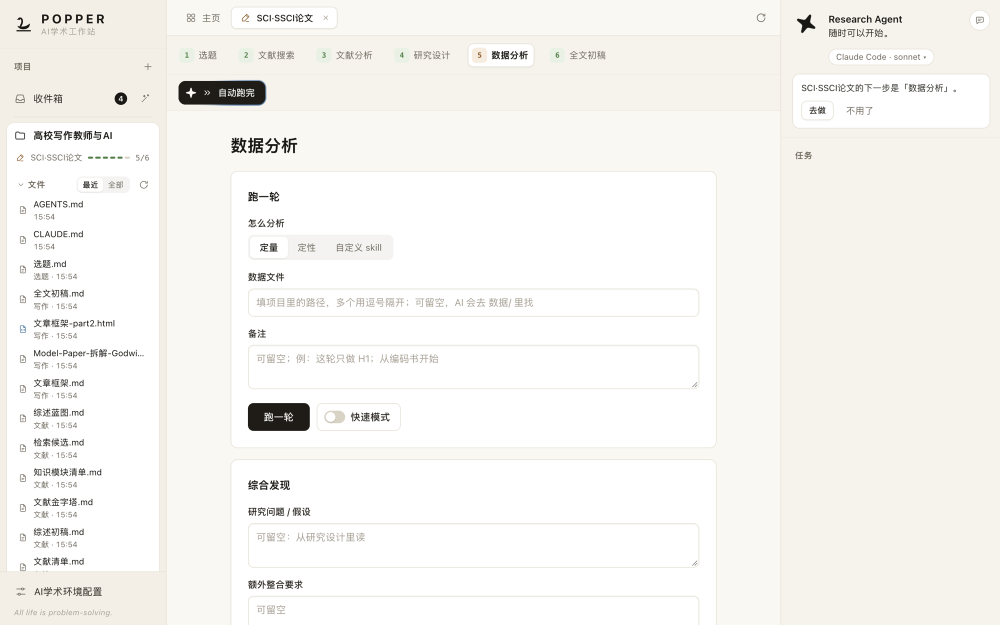
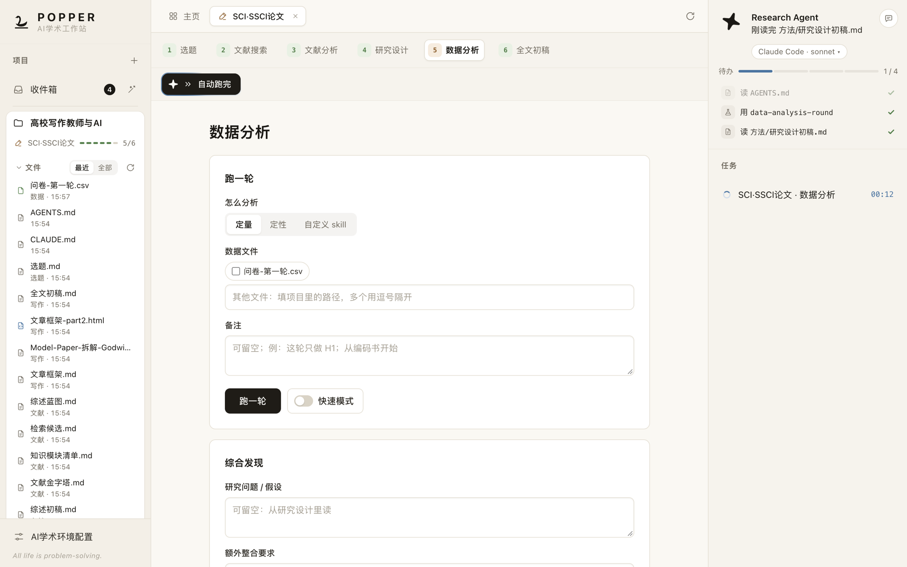
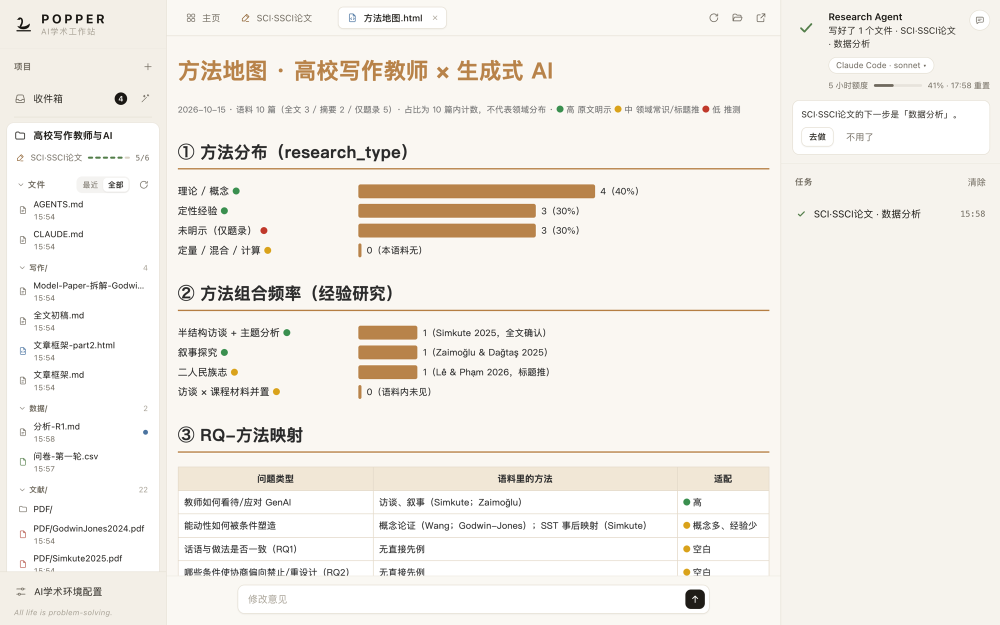
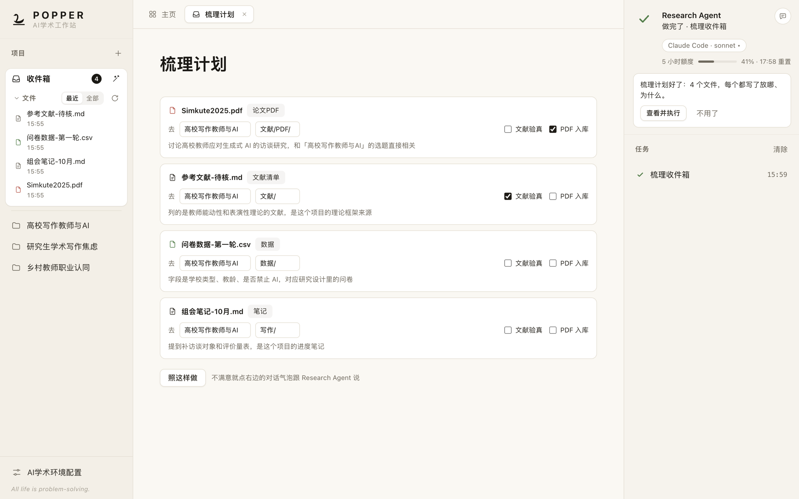
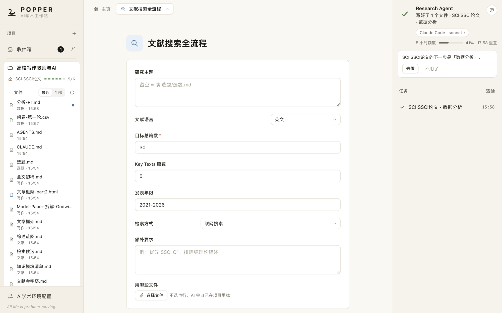

<p align="center">
  
</p>

<h1 align="center">POPPER · AI学术工作站</h1>

<p align="center">
  <b>把一篇论文从选题做到投稿，交给你自己的 AI。</b><br>
  本地运行 · 用你自己的 Claude Code / Codex<br>
  <i>All life is problem-solving.</i> —— Karl Popper
</p>

<p align="center">
  <b>现阶段为「AI学术训练营·进阶班」学员专享</b>
  &nbsp;·&nbsp;
  <a href="#怎么获得">怎么获得</a>
  &nbsp;·&nbsp;
  <a href="#交流与反馈">关注公众号 · 交流群</a>
</p>



POPPER 是一款桌面软件，给想用 AI 做研究、写论文的人。一整套学术工作流——**选题、文献、研究设计、数据分析、写作、综述、投稿与返修**——在这里都是点一下就能开工的工作流和工具。真正动手的是**你电脑上的 Claude Code 或 Codex**，产出直接存进你的论文文件夹。

这些工作流背后的方法，来自乔淼PhD 的「[AI学术训练营](#背后的方法ai学术训练营)」。

<table>
<tr>
<td width="33%" valign="top"><b>🧭 不迷路</b><br>三条工作流把一篇论文拆成清楚的阶段，进度条按你项目里真实存在的产出来算，做到哪一步、下一步做什么，一眼就知道。</td>
<td width="33%" valign="top"><b>🔍 看得见</b><br>AI 在读哪个文件、用哪个方法、写了什么，实时出现在右栏。做完自动列出产出，不靠 AI 自己汇报。</td>
<td width="33%" valign="top"><b>🔒 在你手里</b><br>用你自己的 AI 账号，不用 API key；文件都在你自己的电脑上；每一个关键决定都停下来等你拍板。</td>
</tr>
</table>

---

## 从选题到投稿，一条工作流走到底



一篇论文不是一次对话能写完的。POPPER 把它拆成有先后、有产出的阶段，每个阶段背后是训练营打磨过的方法（skill），上一步的产出就是下一步的输入。

| 工作流 | 走过的阶段 | 适合 |
|---|---|---|
| **SCI·SSCI论文** | 选题 → 文献搜索 → 文献分析 → 研究设计 → 数据分析 → 全文初稿 | 从一个研究想法写到实证论文初稿 |
| **综述文章** | 综述选题 → 检索筛选 → 证据综合 → 综述初稿 | 系统综述、半系统 / 叙事综述、整合式综述 |
| **期刊投稿** | 初稿诊断 → 修改定稿 → 期刊要求核对 → 投稿包 | 已有初稿，准备投稿或返修 |

- **一步一步做，或者「自动跑完」**：一段做完自动开始下一段，中途按默认推进，整条做完再叫你。
- **做完会告诉你下一步**：全文初稿有了，Research Agent 会建议你做投稿前的初稿诊断。
- **还能导入新的工作流**：拿到一个工作流文件，拖进来就能用。

---

## 你说做什么，AI 动手做——每一步都看得见



点「执行」，POPPER 把指令连同项目信息一起交给你的 AI。右上角的星芒开始转，右栏一行行出现它正在做的事：读了哪个文件、调用了哪个方法、待办做到第几项、额度还剩多少。

- **该你拍板时会停下来**：AI 有问题要问，任务变成「等你回复」并提醒你；回复之后接着做。
- **排队、停止、追问、重试**：同一个项目的任务自动排队，不同项目可以同时跑；出错时把报错翻成人话，一键重试或换另一个 AI 重做。
- **留痕**：每次交给 AI 的指令原文、每个任务的产出，都记在项目里，以后随时能查。

---

## 产出就在手边，改起来也方便



AI 写好的文件在左栏带蓝点提示，点开就在中间显示：Markdown 排好版，PDF、表格、图片、AI 做的可视化网页都能直接看。

想改哪里，在下面写一句修改意见交给 AI——POPPER 会先把原文件备份好再动手。

---

## 文件太乱？收件箱一键梳理



下载的 PDF、随手记的笔记、导出的数据，先一股脑扔进收件箱。点魔杖，AI 给每个文件出一份去向：放进哪个项目、哪个文件夹、为什么，还能顺手勾上「文献验真」「PDF 入 Zotero」。你看过、改过、点「照这样做」，POPPER 才开始搬；搬错了一键撤销。

---

## 21 个工具，随取随用



不想走完整条工作流？每一步都能单独用，只填 AI 猜不到的那几项。

| | |
|---|---|
| **找文献** | 文献搜索全流程 · 文献验真（逐条实查参考文献是不是真的）· 金字塔分层 · PDF + 入 Zotero |
| **读文献** | 单篇深读（每条结论带页码）· 知识模块清单 · 模块生成 · Gap 识别 |
| **写综述** | 写综述 · 综述蓝图 · 综述初稿组装（附引用核验报告和 Word 版） |
| **研究设计** | 方法地图 · 研究设计初稿 |
| **数据分析** | 跑一轮分析（定量 / 定性 / 你自己的方法）· 综合发现 · 数据 skill 工坊（从方法学教材造一个自己的分析方法） |
| **写全文** | 拆 Model Paper · 反推框架 · 全文扩写（缺数据就占位，绝不编造） |
| **审稿返修** | 审稿意见台账 · 返修改稿与回复 |

打开「快速模式」，AI 只在非问你不可的地方停一次，最后列出它替你做的决定。你自己装的 skill，也能一键做成「我的工具」。

---

## 项目就是一个文件夹

- 新建项目，或者**把电脑上现有的文件夹直接拖进左栏**，它就成了一个项目——POPPER 只加一个 `.工作站` 小文件夹，不动你原有的文件。
- 每个项目有一份项目说明，AI 每次开工先读它；你可以在里面写自己的规矩（比如目标期刊、写作风格）。
- 所有工作流和工具按同一张「文件放哪」表读写：`选题/ 文献/ 方法/ 数据/ 写作/`。
- `⌘K`（Windows 上 `Ctrl+K`）随时搜项目、工作流、工具和文件。

---

## 你的数据，你的 AI

- **全在本地**：POPPER 只在你的电脑上运行，只对本机开放，只会连 GitHub 检查更新。
- **用你自己的 Claude Code / Codex**：POPPER 不保存、不经手你的 AI 账号和密码，额度也是你自己的。
- **AI 只在项目文件夹里干活**。
- **工作流在沙箱里运行**：导入的工作流读不到 POPPER 和别的工作流的数据；只有你真的点了「执行」，指令才会交给 AI。
- **更新带签名**：每份更新都签过名，被篡改的更新 App 会拒绝。

---

## 一直在变好

新的工作流、工具和界面改进会**自动下载**，左下角出现「立即更新」，点一下就生效，不用重装。需要换新版安装包时，左下角会出现「下载新安装包」。

---

## 怎么获得

POPPER 现阶段是「**AI学术训练营·进阶班｜AI学术工作流实操与开发**」的学员专享软件，安装包在课程里发放。想了解进阶班，欢迎关注公众号「**乔淼PhD**」（[扫码](#交流与反馈)）。

支持的电脑：**Mac**（Apple 芯片：M1 及以后）、**Windows** 10 / 11（64 位）。Intel 芯片的 Mac 暂时用不了。

## 安装

**装之前**：至少装好 **Claude Code** 或 **Codex** 其中一个的**命令行版**，并用自己的账号登录过（Mac 上装了 ChatGPT 桌面版一般已经自带 Codex 命令行版；Windows 上要单独装）。还没装也没关系：打开 POPPER 后在「AI学术环境配置」里点「怎么装」，复制一行官方安装命令就能装好。

**Mac**：打开 dmg，把 POPPER 拖进「应用程序」。第一次打开如果提示「Apple 无法验证“POPPER”」，点「完成」，到「系统设置 → 隐私与安全性」往下拉，点「仍要打开」，再输一次开机密码。如果提示「已损坏，无法打开」，在「终端」里运行下面这行再打开：

```
sudo xattr -dr com.apple.quarantine /Applications/POPPER.app
```

**Windows**：解压到一个固定位置，双击 `POPPER.exe`。出现「Windows 已保护你的电脑」时，点「更多信息」→「仍要运行」。

**装好后第一件事**：点左下角「AI学术环境配置」→「课程 skills」→「**装到 Claude Code**」或「**装到 Codex**」，POPPER 会直接把 44 个学术 skills（[ai-academic-workflow](https://github.com/qiaomiaojoe/ai-academic-workflow)）装好。文献检索工具、Zotero、pandoc 也在这里检查。

---

## 常见问题

**要 API key 吗？**
不用。AI 用的是你自己的 Claude Code / Codex 账号和额度。

**数据放在哪？**
项目就在你选的文件夹里（默认「文稿 / AI学术工作站」）。设置和任务记录在 Mac 的 `~/Library/Application Support/AI学术工作站/`，Windows 的 `%APPDATA%\AI学术工作站\`。

**和以前的「AI学术工作台」App 是什么关系？**
POPPER 是它的新一代，已经替代它；旧 App 不再更新。

**出了问题怎么办？**
到 [AI学术交流群](#交流与反馈) 里说一声，讲清楚在哪一步、看到了什么；需要的话，菜单「帮助 → 打开数据文件夹」，把里面的内容压缩后发上来。

---

## 背后的方法：AI学术训练营

POPPER 里的每一条工作流、每一个工具，都来自乔淼PhD 在「**AI学术训练营**」里讲授和打磨的学术工作流：怎么选一个立得住的题、怎么找文献和读文献、怎么设计研究和分析数据、怎么把论文写出来并投出去——以及每一步怎么和 AI 协作，既用好 AI，又守住学术诚信。

想了解训练营，欢迎关注公众号「**乔淼PhD**」（扫下面的二维码）。

---

## 交流与反馈

<p>
  
</p>

**微信扫码关注公众号「乔淼PhD」**：最新的 AI 学术方法、POPPER 和进阶班的消息，以及加入 AI学术交流群的方式，都在公众号里。使用问题、功能建议、你用 POPPER 做出来的东西，都欢迎到交流群里聊。

---

## 版本

| 版本 | 日期 | 新内容 |
|---|---|---|
| 1.1.3 | 2026-10-22 | 文件能直接拖进任何一个项目；打开更快（不再等找 AI 程序）；找不到 Claude Code / Codex 时有「怎么装」；课程 skills 由 POPPER 直接下载装好；Windows 上找得到 Codex；OpenAlex key 填写说明 |
| 1.1.2 | 2026-10-19 | 新图标：白底黑天鹅；左栏「最近」文件只显示 6 个；AI 执行时星芒转得更快 |
| 1.1.0 | 2026-10-19 | 把文件夹拖进左栏就能新建项目；星芒空闲时慢转、执行时快转；左上角 logo 放大 |
| 1.0.0 | 2026-10-19 | 第一个正式版 |

---

## 许可

- **POPPER** 软件源代码暂不公开。
- **工作流、工具和 44 个学术 skills 的方法内容**按 [CC BY-NC 4.0](https://creativecommons.org/licenses/by-nc/4.0/deed.zh-hans)（署名—非商业性使用）授权：可以使用、分享和改编，需注明出自「乔淼PhD · AI学术训练营」，不得用于商业用途（包括付费课程、培训和付费产品）。商业合作请通过公众号「乔淼PhD」联系。
- **POPPER 名称和 logo** 保留所有权利：改编的版本请换一个名字。

---

<p align="center">
  <b>POPPER</b> 名字来自科学哲学家卡尔·波普尔。logo 是一只黑天鹅——见过再多白天鹅，也证明不了「天鹅都是白的」；一只黑天鹅就能推翻它。<br>
  开发：乔淼PhD · AI学术训练营<br>
  <sub>这个仓库存放更新包，供已安装的 POPPER 自动下载。使用问题和建议，欢迎到 AI学术交流群。</sub>
</p>
